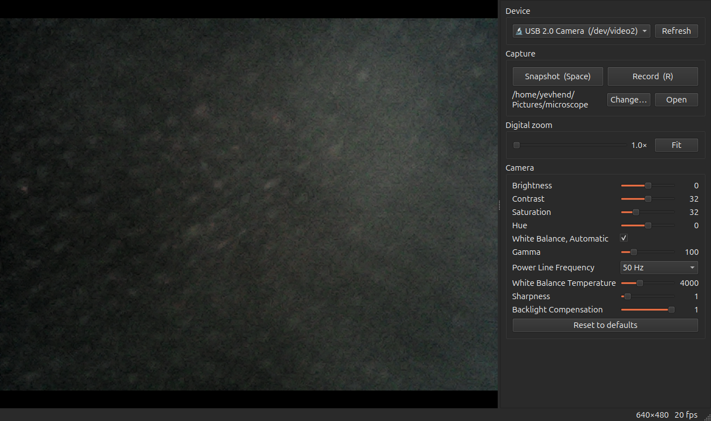

# USB Microscope Viewer

A Linux desktop app for cheap USB digital microscopes and other UVC (USB Video Class) cameras.
The app shows the live image, gives access to all hardware camera settings, and saves snapshots and video.



## Features

- **Live view:** the image fits the window and keeps its aspect ratio. Full-screen mode is available.
- **Device selection:** a dropdown lists all connected cameras. Use the Refresh button after you plug in a camera.
  At start, the app selects the known microscope (USB ID `05e3:f12b`), else the first camera.
- **Camera settings:** the app reads the controls from the device and shows one widget for each control.
  Typical controls are brightness, contrast, saturation, hue, gamma, sharpness, white balance,
  backlight compensation, and power-line frequency. The app disables a control when the camera reports it as inactive.
  "Reset to defaults" restores the values from the device.
- **Digital zoom:** zoom from 1× to 8×. The mouse wheel zooms at the cursor. Drag to move the zoomed view.
- **Snapshot:** saves the visible image (with zoom) as PNG.
- **Recording:** saves the visible image (with zoom) as MJPEG AVI video.
- **Save folder:** default `~/Pictures/microscope`. You can change it, or open it in the file manager.

### Keyboard and mouse

| Input | Action |
|---|---|
| Space | Snapshot |
| R | Start or stop recording |
| `+` / `-` | Zoom in or out |
| 0, or double-click | Fit (zoom 1×) |
| Mouse wheel | Zoom at the cursor |
| Drag | Move the zoomed view |
| F / Esc | Enter or leave full screen |
| Ctrl+Q | Quit |

## Hardware requirements

- A USB camera that Linux supports with the standard `uvcvideo` driver (UVC).
  Most "noname" USB microscopes are UVC devices.
- Tested with a microscope that reports itself as `Genesys Logic USB 2.0 Camera`, USB ID `05e3:f12b`,
  640×480 YUYV at about 20 fps.
- Light intensity and optical zoom on such microscopes are manual (hardware-only).
  The app cannot control them.
- The snap button on the tested microscope sends no event to Linux. Use Space or the Snapshot button instead.

To check that Linux sees your camera:

```bash
ls /dev/video*
cat /sys/class/video4linux/video*/name
```

## Software requirements

| Item | Version |
|---|---|
| OS | Linux with V4L2 (Video4Linux2). Tested on Ubuntu 24.04, kernel 7.0, X11 session. |
| Python | 3.10 or newer. Tested with 3.12. |
| PySide6-Essentials | Tested with 6.12 (Qt GUI) |
| opencv-python-headless | Tested with 5.0 (capture and file writing) |

The app does not run on Windows or macOS, because it uses Linux V4L2 ioctls for the camera settings.

Your user must have access to the video devices. On most distributions, the desktop user has this access.
If you see "Cannot open /dev/videoN", add your user to the `video` group, then log out and in again:

```bash
sudo usermod -aG video "$USER"
```

## Install

```bash
git clone https://github.com/Stihotvor/usb-microscope.git
cd usb-microscope
python3 -m venv .venv
.venv/bin/pip install -r requirements.txt
```

On Ubuntu and Debian, install the `python3-venv` package first if `python3 -m venv` fails.

## Run

```bash
.venv/bin/python microscope.py
```

Options:

| Option | Description |
|---|---|
| `--device /dev/videoN` | Camera to select at start. Default: the microscope, else the first camera. |
| `--out PATH` | Save folder. Default: `~/Pictures/microscope`. |

## Project structure

| File | Purpose |
|---|---|
| `microscope.py` | GUI: main window, video view, camera thread, capture |
| `v4l2.py` | Reads and writes camera controls through V4L2 ioctls |
| `requirements.txt` | Python dependencies |

## Limitations

- Snapshots and video use the camera resolution (640×480 on the tested microscope).
  Digital zoom crops and scales the image, so it does not add detail.
- The app does not detect new cameras by itself. Press Refresh.
- Hardware buttons on the microscope are not supported.

## License

MIT. See [LICENSE](LICENSE).
